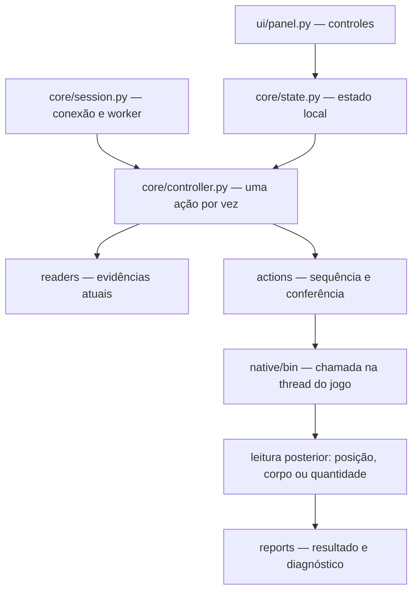

# Estrutura e responsabilidades

## O caminho de uma ação

A interface não chama uma função do jogo ao marcar uma caixa. Ela altera o estado local; o controlador decide quando pode agir. Uma thread em segundo plano executa as operações. O Tkinter continua na thread da interface. O controlador serializa as chamadas para não sobrepor ataque, loot, caminhada e fala.

## Interface e coordenação

| Arquivo | Responsabilidade | Quando alterar |
| --- | --- | --- |
| `iniciar.py` | Localiza o pacote Python e abre a interface. | Inicialização e argumentos de abertura. |
| `src/cromin/ui/panel.py` | Janela 260x100, seis seções, barra O/S/P/+/D/-/X, temas, campos e mensagens. | Visual e novos controles. Não colocar offsets aqui. |
| `src/cromin/core/state.py` | Estado compartilhado entre janela e worker, protegido por lock; flags dos módulos e cópias independentes. | Novas configurações e indicadores. O nome antigo era ui_ipc; aqui não há IPC com o jogo. |
| `src/cromin/core/session.py` | Procura processo, confere build/thread, impede dois controladores no mesmo PID e encerra recursos. | Conexão e reconexão. |
| `src/cromin/core/controller.py` | Agenda ações, verifica healing, coordena combate/loot/cavebot/luz, salva configurações e log. | Prioridade e funcionamento contínuo. |
| `src/cromin/core/targeting.py` | Valida a lista de nomes e a correspondência do filtro. | Política de seleção. |
| `src/cromin/core/profiles.py` | Valida configurações JSON para abrir/salvar pela barra O/S. | Novos campos e migração de configurações. |
| `src/cromin/core/look_observer.py` | Inicia/cancela a captura externa de Look e atualiza o último ID. Confirma detach antes das ações. | Captura de Look e coordenação com os helpers. |
| `src/cromin/core/paths.py` | Centraliza caminhos de binários, configurações e relatórios. | Mudanças de instalação ou armazenamento. |

Flags atuais: ataque 1, loot 2, cavebot 4, healing 8, repetir rota 16, luz 32. Repetir rota é configuração; não dispara uma ação sozinho. Todos os módulos começam desligados.

## Leitores

| Arquivo | Responsabilidade |
| --- | --- |
| `readers/build.py` | Cabeçalhos PE carregados, módulos, identificação da build e hashes. |
| `readers/memory.py` | Abre o processo para leitura, fornece leitura exata e utilidades do scanner de valores herdado. Não representa permissão de escrita para luz. |
| `readers/bag.py` | Lista containers e itens; confere a build antes dos testes. |
| `readers/world.py` | Jogador, mapa, tiles, corpos e monstros com filtro de nomes. Valida identidade e distingue alvo inválido de candidato utilizável. |

Os leitores retornam evidências; não decidem o que atacar ou transferir. Ainda há constantes e offsets espalhados em leitores e fontes nativos. Centralizar tudo em um perfil único é uma atualização planejada, não uma propriedade já existente.

## Ações Python

| Arquivo em `src/cromin/actions/` | Responsabilidade |
| --- | --- |
| `common.py` | Executa helpers, coleta saída/JSON, confere conclusão e define SkipCycle. Não mata uma chamada em andamento por timeout. |
| `follow_watch.py` | Observa parada longe do mesmo alvo, limita tentativas e renova ChaseMode sem repetir ataque. Compartilhado pelos ciclos e pelo controlador enquanto o ataque permanece ativo. |
| `target_attack.py` | Solicita um ataque ao Monster escolhido por ID/objeto/nome e acompanha a mesma identidade; não executa loot genérico. |
| `combat_cycle.py` | Seleciona Rat, solicita ataque único, acompanha perseguição, associa um corpo novo e encaminha ao loot. Alvo vivo fora do mapa vira target_lost. |
| `open_loot.py` | Confere corpo e bag, abre uma janela nova, coleta moedas e confere totais. |
| `loot_transfer.py` | Planeja uma transferência, chama o helper de movimento e compara quantidades antes/depois. |
| `light.py` | Confere jogador, escreve somente o byte candidato +0xF1 e tenta restaurar o valor ao desligar. |

SkipCycle é uma falha recuperável de evidência do mundo: tile não observado, corpo ausente/ambíguo, fora de alcance ou tile alterado durante leitura. O controlador registra e continua, sem abrir corpo incerto. Falha de chamada/restauração, identidade divergente ou estrutura inesperada não é ignorada genericamente.

## Ações nativas e observador

| Fonte em `native/src/` | Executável em `native/bin/` | Função |
| --- | --- | --- |
| `rat_attack_once.cpp` | `OTC_Rat_Attack_Once.exe` | Obtém referência própria do Rat e solicita Game::attack. Valida Rat no modo legado; no modo novo valida o nome/ID/objeto escolhidos para qualquer Monster. Opcionalmente aplica e confere ChaseMode antes do lookup/ataque. |
| `corpse_open_once.cpp` | `OTC_Corpse_Open_Once.exe` | Confere corpo 3994 no tile e solicita Game::open. |
| `loot_once.cpp` | `OTC_Loot_Once.exe` | Confere origem/destino/item e solicita Game::move. Ainda valida moeda 3031 e bag 2853. |
| `autowalk_once.cpp` | `OTC_AutoWalk_Once.exe` | Solicita LocalPlayer::autoWalk uma vez. Python acompanha chegada. |
| `talk_once.cpp` | `OTC_Talk_Once.exe` | Solicita Game::talk uma vez. Retorno não garante aceitação da magia pelo servidor. |
| `look_watch.cpp` | `OTC_Look_Watch.exe` | Observa a chamada real de Look e informa o ID do Item sem executar Look automaticamente. |
| `trace_walk.cpp` | Incluído pelos outros fontes | Utilidades Windows, conferência de build, depuração e restauração. Não é o ponto de entrada do painel. |

O helper de ataque foi generalizado e recompilado nesta entrega de Targeting. Os outros quatro binários continuam iguais à base anterior. Uma alteração só em Python não remove as restrições fixas do C++.

## Dados e evidências

- `data/Cromin_Externo.settings.json`: HP, intervalo, magia, bag, luz e waypoints. Não contém um perfil completo de build.
- `reports/external_session_*.jsonl`: cada linha é um evento com horário e dados. Procure cycle_skipped, target_lost, native, attack_loot_cycle e fault.
- `reports/loot_once_*.json`: confirmações de transferência e quantidades.
- `reports/rat_attack_once_*.json`, `corpse_open_native_*.json` e `loot_native_*.json`: resultado dos helpers e restauração.
- `VALIDACAO.json`: manifesto da entrega e limites dos testes. Não substitui evidência ao vivo.

## Onde mexer para cada atualização

1. **Novo controle:** panel → state → controller. Persistir em load_settings/save_settings e testar estado inicial desligado.
2. **Novo campo lido:** readers → teste com memória simulada → evidência ao vivo.
3. **Nova ação do cliente:** leitor e validação → fonte C++ e fixture → chamada única → leitura do resultado → só depois scheduler contínuo.
4. **Novo item de loot:** configuração e totais Python **e** validação/slot/count no helper C++. Count/subtype bruto nem sempre significa quantidade.
5. **Build atualizada:** localizar/validar offsets e funções novamente; alterar perfil/verificações e repetir testes. Não reutilizar endereços absolutos da sessão passada.

Follow é uma configuração targetFollow em core/state.py, persistida como target_follow. O controlador repassa o valor para combat_cycle ou target_attack; ambos exigem confirmação de chase no relatório nativo. Tools usa lightLevel=31 e as configurações antigas migram para 31.

WorldSnapshotUnavailable é um subtipo recuperável de SkipCycle usado nas verificações estruturais da árvore do mapa. O controlador registra map_scan_skipped e não zera o waypoint nem desativa módulos. Uma varredura incompleta não retorna candidatos. Veja RECUPERACAO_MAPA.md.

A V6 adiciona um sexto executável, o observador de Look; os cinco helpers existentes não foram alterados. Controller.record usa um lock para manter os eventos do leitor do observador e do controlador no mesmo JSONL sem intercalar linhas.

A V7 altera o helper de ataque para incluir renovação independente de ChaseMode (sem lookup/ataque) e adiciona follow_watch.py. Os outros cinco executáveis permanecem iguais à V6. O Cavebot marca LOOP ao ser ativado na interface. Consulte ATUALIZACAO_V7.md para temporização, validação e limites.

## Atualizacao V8: Loot e Drop

core/loot_policy.py valida as listas e rejeita sobreposicao entre recolher e descartar. Os campos corpseIds/lootIds/dropIds ficam no estado; corpse_ids/loot_ids/drop_ids ficam nos JSONs. O perfil antigo migra para 3994/3031/Drop vazio.

actions/item_loot.py e o caminho configuravel usado pelo painel. O caminho legado de moeda foi mantido para os diagnosticos antigos. open_loot encaminha para o novo modulo quando recebe LootPolicy. combat_cycle tambem recebe selected e LootPolicy para acompanhar outro Monster e associar um corpo configurado. world.items_at retorna itens de um tile; corpses_at filtra conforme corpse_ids.

Foram recompilados OTC_Corpse_Open_Once.exe e OTC_Loot_Once.exe: o primeiro aceita --corpse-id; o segundo recebe ID/objeto/janela atuais e pode usar --ground 1 com coordenadas e identidade do tile do jogador. O helper confere novamente essas evidencias antes da chamada. Os outros quatro executaveis permanecem iguais a V7. Veja LOOT_DROP_V8.md.

## Atualizacao V9

FOOD usa bit 64 no ACTION_MASK; foodIds e foodStatus ficam no estado e food_ids no JSON. AutoFood e agendado por Controller.pulse depois do healing, com a mesma exclusao de helpers/observador Look. actions/food.py controla intervalo e observacao. actions/contained_item.py valida o contrato do helper OTC_Item_Use_Once.exe para usar item ou abrir bag em container. item_loot percorre as bags 2853 de forma limitada e verifica cada janela nova antes de ler o conteudo. A leitura instavel agora gera SkipCycle inclusive no preflight de combate.

O Cavebot ignora a configuracao antiga de volta unica: a rota sempre circula enquanto CAVE estiver ligado. A constante LOOP=16 permanece como compatibilidade de codigo legado, mas nao e necessaria para repetir e nao tem controle na UI. O estado inicial tem flags=0. Veja ATUALIZACAO_V9.md.
